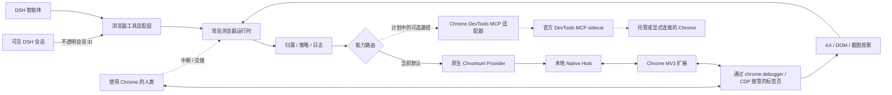

# dsh-native-browser

> 面向 DSH 的原生浏览器控制面：在你已经登录、已经打开的 Chrome 里，提供快速、可见、可随时接手浏览体验。

[简体中文](README.zh-CN.md) | [English](README.md)

[](#项目状态)
[](#范围)
[](LICENSE)

`dsh-native-browser` 让 DSH 智能体直接操作你正在使用的 Chrome：现有标签页、已登录会话和日常扩展都能保留，同时提供低延迟的语义观察、可靠的动作、可见的交接和随时可中断的人机协作。

这个项目不是又一个通用 Chrome MCP Server。Google 官方的 [Chrome DevTools for agents](https://github.com/ChromeDevTools/chrome-devtools-mcp) 更适合承担 DevTools 检查、网络分析、性能追踪、Lighthouse、CSS 和内存调试等底层能力；`dsh-native-browser` 专注通用 MCP Server 不负责的产品层：DSH 会话身份、精确的标签页归属、短租约、审批策略、动作结果语义、可见的智能体存在感和即时人工接管。

目标也不是再包一层 `click(x, y)`。它是一套有状态的浏览器运行时，借鉴了 Codex Chrome 集成里最有效的部分：

- Manifest V3 Chrome 扩展通过 Native Messaging 连接本地运行时；
- 基于 CDP 控制，但不启动第二个浏览器 Profile；
- 以可访问性树（AX）为主的观察，配合紧凑的增量更新；
- 稳定的元素引用，加上动作可用性和命中目标校验；
- 对已有标签页、智能体新建标签页和回合结束清理都有明确归属；
- 当可见 DSH 界面切换到其他会话时，自动释放浏览器控制权；
- 支持即时人工中断和可恢复的交接；
- 在真实输入被验证后，显示只用于展示的虚拟指针和点击/滚轮脉冲；
- 截图只作为视觉兜底，而不是默认的页面结构来源。

## 定位

长期方向是 **DSH 原生编排 + 适配合适的第一方 Chrome 能力**，而不是 Fork 一份 Chrome DevTools。

| 关注点 | Chrome DevTools for agents | `dsh-native-browser` |
|---|---|---|
| 主要职责 | 通用 MCP/CLI 访问 Chrome DevTools | DSH 原生的个人浏览器控制和人机协作体验 |
| 浏览器状态 | 托管 Profile、调试端点或自动连接 | 在用户现有 Profile 中显式接管标签页 |
| 观察方式 | 可访问性快照与可复用 UID | 有界 AX 窗口、文档 epoch、作用域引用和增量观察 |
| 动作结果 | 派发输入并做有限等待 | 派发前命中校验、持久动作日志、已验证/未知的结果语义 |
| 归属 | 选中页面或显式页面 ID | DSH owner、标签页租约、会话焦点撤销和交接 |
| 人类可见性 | 有头浏览器，暂未内置视觉光标 | 只用于展示的虚拟指针、点击/滚轮脉冲和扩展 Stop |
| 深度调试 | 网络、控制台、CSS、Lighthouse、Trace、Heap | 计划通过可选官方 DevTools Provider 接入，而不是重写 |
| 浏览器范围 | 官方支持 Chrome 和 Chrome for Testing | Chrome 优先，协议可移植，早期 Edge 兼容门禁 |

当前 alpha 只交付原生 Chromium 路径。`chrome-devtools-mcp` 适配器是计划中的 Provider，不是已实现功能；它必须先通过附加冲突、生命周期、隐私和延迟门禁，才可能共享或替代活跃浏览器会话。

## 产品对标：Codex

体验对标是 OpenAI Codex 的浏览器集成：浏览器工作应该像一次连续、可观察的协作，而不是一串断开远程调用。目标是在可度量范围内对齐体验，而不是协议兼容、视觉模仿或使用 OpenAI 私有实现。

`dsh-native-browser` 重点对标以下行为：

- **使用用户已经在用的浏览器**：保留登录态、已打开标签页和正常 Chrome 扩展，而不是让日常任务从一次性自动化 Profile 开始。
- **快路径保持语义化**：先读紧凑的可访问状态和稳定元素引用；只有像素里包含必要信息时才用截图和视觉。
- **动作既可见又可信**：显示虚拟指针便于人类观察，输入前重新校验命中目标，并在输入后验证页面状态，而不是把“输入已派发”当作成功。
- **人类随时可以接管**：Stop、交接、焦点切换和租约到期都能立即撤销控制。
- **把精确性当作产品指标**：过期引用、误点击、重复动作和无法解释的“成功”都是发布门禁，不是可接受的噪声。

## 项目状态

**公开 alpha——可用于主动选择的 Chrome 测试，尚未达到生产可用。** 包内包含类型化运行时、每用户 Broker、Native Messaging Host、Chrome/Edge 共享扩展构建、Chromium AX/动作 Provider、DSH Web 前台会话桥，以及九个 DSH 工具，覆盖有界实时页面窗口、分步审批的动作批处理和仅元数据的 frame 发现。Chrome 安装仍需手动加载 unpacked 扩展，广泛页面兼容性、视觉模型准确率和生产加固仍是待验收工作，而不是已完成承诺。

目前已验证：确定性契约/安全测试；将 npm tarball 精确安装到全新 DSH Profile；在隔离 Chrome-for-Testing Profile 中组装本地全链路；以及在已有本地 Chrome Profile 上针对自有 fixture 的一次端到端运行。真实 MV3 扩展、Chrome 启动的 Native Host、Unix socket、Broker、已安装 DSH ToolRuntime、AX 动作、截图附件和交接路径都已被执行。实时门禁还覆盖延迟结果、取消、Stop、回合结束后的迟到审批，以及 Broker 重启不重放。尚未有敏感业务账号流程或生产级视觉模型准确率通过验收。精确证据与限制见 [开发说明](docs/development.md) 和 [实现进度](docs/implementation-progress.md)。

早期 Edge 兼容性冒烟也能在隔离 Edge Profile 中通过同一套 runtime-core：20 个未改动的执行器 fixture oracle，加上批处理、分页、导航、Stop 和交接检查。这是架构门禁，不是正式 Edge 发布支持；证据见 [兼容性记录](docs/compatibility/2026-09-12-edge-native.json)。

## 范围

Frame 发现目前能在真实隔离 Chrome 和 Edge 测试中映射同进程和递归 OOPIF 文档。显式 `browser_observe` frame 读取支持同源祖先链，带独立子文档引用/增量，并可通过 `frame` + `query` + 可选 `rootRef` 在指定子文档或已知区域内精确查询；`browser_read_page({frame,...})` 提供有界子文档/区域窗口；显式同源/同进程子 frame 点击使用 `browser_act({frame,...})` 并做子文档内文本验证，包括默认有界视图之外的反馈。其他子 frame 动作和跨源审批仍待完成。Frame origin 只是元数据，不是权限。截图会检查所有已附加会话；包含外部或不透明子文档的可见顶层 iframe 分支会在 MV3 内被脱敏后才离开 Chrome，几何不完整时仍然失败关闭。详见 [frame 发现](docs/development.md#frame-discovery-foundation)。

首个生产版本的范围：

- 先支持 macOS 上的 Google Chrome stable；Windows/Linux 通过独立安装器和兼容性门禁跟进；
- 用户现有 Chrome Profile 和已登录会话；
- DSH `web` 和 `desktop` Profile；
- 语义浏览、截图、下载、对话框、文件和多标签工作流；
- 仅本地控制面，显式权限和可审计生命周期事件。

架构接口从第一天起就是跨浏览器的。暂缓的生产支持包括：

- Edge 和其他 Chromium 品牌（共享引擎；正式支持前先做早期冒烟）、Firefox 和 Safari（独立 Provider）；
- 托管/远程浏览器农场；
- 绕过 CAPTCHA 或隐身类能力；
- 直接向模型暴露不受限制的原始 CDP。

## 计划架构



运行时把活跃浏览器对象和事件订阅隔离在模型上下文之外。模型只收到紧凑、类型化的观察和稳定引用；运行时在动作前立即完成新鲜度、可见性、稳定性和命中目标校验。能力路由对 DSH 暴露很小的表面，因此未来增加 DevTools 或 Edge/Firefox Provider 时，不会把几十个厂商工具灌进模型上下文。

## 安装 alpha

前置条件：macOS、Google Chrome、DSH `0.1.5-rc.1`、Node.js 22.19 或更新版本、pnpm 11。npm 包已经包含构建好的 JavaScript，安装时不会执行构建脚本。

```bash
dsh plugin --profile web add dsh-native-browser@0.1.0-alpha.6
dsh plugin --profile web exec dsh-native-browser setup --browser=chrome
```

`setup` 会打印打包扩展目录和稳定扩展 ID，并注册 Native Messaging Host。打开 `chrome://extensions`，启用开发者模式，选择 **Load unpacked**，选中打印出来的目录。如果之前加载过旧的 unpacked 构建，请先移除，再加载当前版本。

带精确允许列表启动本地 Broker。Origin 必须精确并包含端口；多个站点重复传 `--allow-origin`：

```bash
dsh plugin --profile web exec dsh-native-browser broker --allow-origin=https://example.com
```

在 Chrome 中打开允许的页面，点击扩展，批准该标签页，然后重启 DSH Profile。`approvalMode` 默认是 `per-action`。进阶测试者可以在 Profile patch 的 `native-browser` 行选择 `per-lease`，或使用非空精确 `trustedOrigins` 的 `trusted`。Trusted 只对精确 origin 去掉重复 DSH 提示；扩展同意、实时租约、Stop 和 origin 检查仍然生效。使用已登录页面前，请先看 [显式安装与诊断指南](docs/development.md#explicit-chromeprofile-setup)。

对于个人 Chrome Profile，显式 personal 模式会让已允许的标签页免提示，并在无凭据的 HTTP(S) 根导航中跟随同一个标签页：

```bash
dsh plugin --profile web exec dsh-native-browser broker --access-mode=personal
```

```yaml
- id: native-browser
  config:
    approvalMode: personal
```

Broker 和适配器设置必须同时存在，否则 claim 会失败关闭。扩展启动时协商 Broker 的显式 personal 模式能力，之后无需点击 popup 就能暴露普通 HTTP(S) 标签页；claim 仍只选一个标签页，每个操作仍受短标签页租约约束。开发版 manifest 声明 HTTP(S) host 访问，Chrome 安装时会提示，personal 模式和虚拟指针才能在跨站导航后继续可用。前台会话切换、租约过期、交接、断连和扩展 Stop 都会撤销控制。alpha 没有针对支付、发布或破坏性动作的可靠语义分类器，不要在这些流程里使用 personal 模式。

当可见 DSH 界面切换会话时，客户端桥会先释放其他会话拥有的浏览器作用域，再让新会话 claim。新会话永远不会继承旧租约。切走会有意中断正在进行的浏览器任务，而不是让后台聊天继续驱动 Chrome。

## 使用当前 alpha

当前 npm 版本是 `0.1.0-alpha.6`。以下示例使用 DSH `web` Profile；如果安装到其他 Profile，请保持一致替换。

### 开始一次浏览会话

1. 确认已按上面的说明安装 unpacked 扩展和 Native Messaging Host。升级 npm 包后，在 `chrome://extensions` 重新加载扩展；扩展文件来自已安装包版本，不会在运行中自动更新。
2. 在终端启动一个 Broker 并保持运行。普通个人浏览：

   ```bash
   dsh plugin --profile web exec dsh-native-browser broker --access-mode=personal
   ```

   DSH Profile patch 中匹配的 `native-browser` 行必须是：

   ```yaml
   - id: native-browser
     config:
       approvalMode: personal
   ```

   修改 patch 后重启该 DSH Profile。若要保留显式 per-action 或 per-lease 审批，则用精确 `--allow-origin=` 启动 Broker，并使用对应的适配器审批模式。不要对同一个运行时目录同时运行受限和 personal Broker。
3. 在 Chrome 打开要使用的标签页。Chrome 或扩展询问站点访问时，只授予目标标签页/站点。扩展 popup 同时也是紧急 Stop 控件。
4. 正常和 DSH 对话。智能体会自动发现 `browser_*` 工具；用户不需要构造 lease ID、元素引用、document epoch 或 request ID。

首次运行的稳妥提示：

```text
列出我当前 Chrome 中可用的标签页，只汇报，不做任何操作。
接管标题为“Example Domain”的标签页，读取页面内容，然后释放浏览器控制。
在我指定的标签页中填写这个测试表单，提交前先停下来让我确认。
```

更长任务请明确目标标签页和停止条件。DSH 会 claim 该标签页、观察语义页面状态、执行支持的动作，并在要求时用 `browser_handoff` 释放。claim 是独占的：另一个 DSH 会话不能复用。切换可见 DSH 会话会有意撤销前一个会话的浏览器控制，因此请让新会话重新 claim。

### 当前版本能做什么

- 列出已连接的 Chrome 实例和可用现有标签页；
- claim 一个标签页并读取有界可访问文本、控件和命名区域；
- 导航、点击、填充、追加文本、按键、设置 checkbox/radio、滚动、发送经验证的滚轮事件、给已观察的 `<input type=file>` 设置文件、接受原生文件选择框、捕获页面触发的下载；
- 运行最多八个显式动作的有界批处理，在拒绝、不确定或验证失败时停止；
- 分页读取大型语义文档，并读取支持的同源子 frame；
- 将当前视口捕获为 DSH 附件，并把控制权交还用户；
- 在经验证的点击或滚轮派发后显示短时虚拟指针。

正常快路径是语义观察而不是截图。本插件会发布截图附件，但自身不运行视觉模型；视觉定位需要支持视觉的 DSH 会话和单独配置的工具，例如 `dsh-vision-router`。扩展会在截图字节离开 Chrome 前脱敏可安全定位的外部/不透明 frame 区域，但 frame 清单或脱敏几何不完整时仍失败关闭。截图被拒绝时，授权根页面的文本读取和语义动作通常仍可工作。

### 检查安装

运行打包安装诊断和可选的原始连接状态：

```bash
dsh plugin --profile web exec dsh-native-browser doctor --browser=chrome
dsh plugin --profile web exec dsh-native-browser status
```

`doctor` 报 `ready` 只证明本地注册、Broker 协议和匹配的已连接扩展健康；它不会授予标签页租约，也不证明任意站点可用。如果 DSH 列不出标签页，请检查运行中的 Broker 模式、扩展/站点同意，以及 DSH 适配器是否使用匹配的审批模式。截图时出现通用 `Remote operation failed`，当前可能意味着跨源 frame 策略拒绝了图像；先改为读/观察页面并查看 DSH trace，再决定是否重试。

## 开发

前置条件：Node.js 22.19 或更新版本，pnpm 11。

```bash
pnpm install
pnpm check
pnpm test
pnpm test:chrome
pnpm pack
```

只建议使用明确版本号的 alpha 做测试。不要用于支付、破坏性业务动作、密码输入或无人值守操作。

提交改动前请阅读 [CONTRIBUTING.md](CONTRIBUTING.md)。安全敏感问题请遵循 [SECURITY.md](SECURITY.md)，不要开公开 issue。

## 致谢

本项目受益于浏览器智能体生态的优秀工作：

- [Chrome DevTools for agents](https://github.com/ChromeDevTools/chrome-devtools-mcp)（Google ChromeDevTools 维护）展示了标准 MCP 表面如何让 Chrome 自动化、调试和性能分析广泛可用。其 DevTools 能力是未来优先的集成路径。
- [OpenAI Codex](https://openai.com/codex/) 启发了“连续、可见、易于交还人类”的浏览器产品目标。`dsh-native-browser` 是基于公开行为和文档的独立实现，与 OpenAI 无隶属或背书关系。
- [DeepSeek Harness](https://github.com/deepseek-ai/deepseek-harness) 提供了本包所面向的插件、Profile、工具和审批模型。
- [Chrome DevTools Protocol](https://chromedevtools.github.io/devtools-protocol/)、Chromium Accessibility 和 Chrome Extensions 平台提供了原生 Provider 背后的浏览器原语。
- [Puppeteer](https://github.com/puppeteer/puppeteer) 和 [Playwright](https://github.com/microsoft/playwright) 提供了浏览器生命周期、locator、动作可用性和测试方面的重要参考实现。
- [dsh-vision-router](https://github.com/ysr666/dsh-vision-router) 帮助界定了可选视觉兜底边界：截图和视觉补充语义观察，而不是替代它。

名称和商标归各自所有者。致谢不代表赞助或背书。未来引入的第三方源码会保留其许可证和声明信息。

## 设计原则

1. **快路径是语义化的。** 日常操作用 AX/DOM 状态，只有像素承载关键含义时才用图像。
2. **动作验证现实。** 重新解析目标、滚动、等待稳定、命中测试、执行动作，然后观察结果变化。
3. **浏览器状态有归属。** 用户已有标签页要 claim 和释放；智能体标签页要跟踪并清理。
4. **人类控制立即生效。** 用户交互或扩展 Stop 会取消进行中的工作并产生可恢复状态。
5. **会话焦点是控制边界。** 切换可见 DSH 会话会撤销后台浏览器作用域；权限只释放，不转移。
6. **能力是显式的。** 敏感操作窄而明确、受策略约束且可审计；原始 CDP 只是内部传输。
7. **性能要度量。** 延迟、观察大小、过期引用率、动作成功率和恢复行为都是基准门禁。

虚拟指针提升可观察性，但绝不是输入原语：先做语义发现和最后一刻命中测试选择目标，浏览器派发真实输入，之后扩展才绘制指针。绘制失败不能授权、改变目标、延迟或重放动作。

## 许可证

[MIT](LICENSE)
